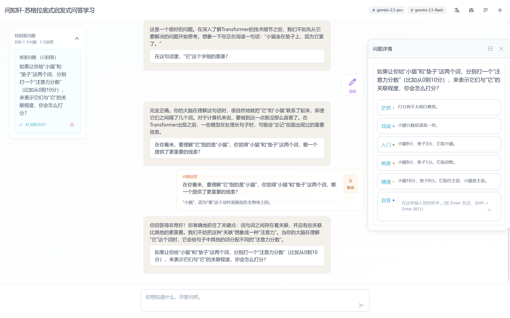
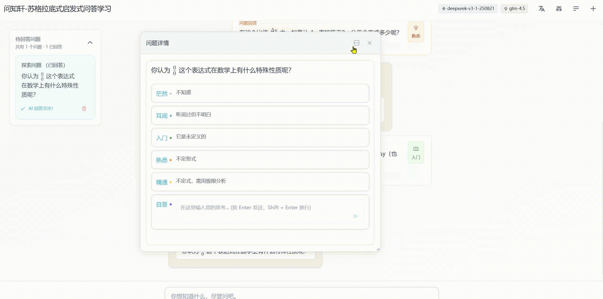
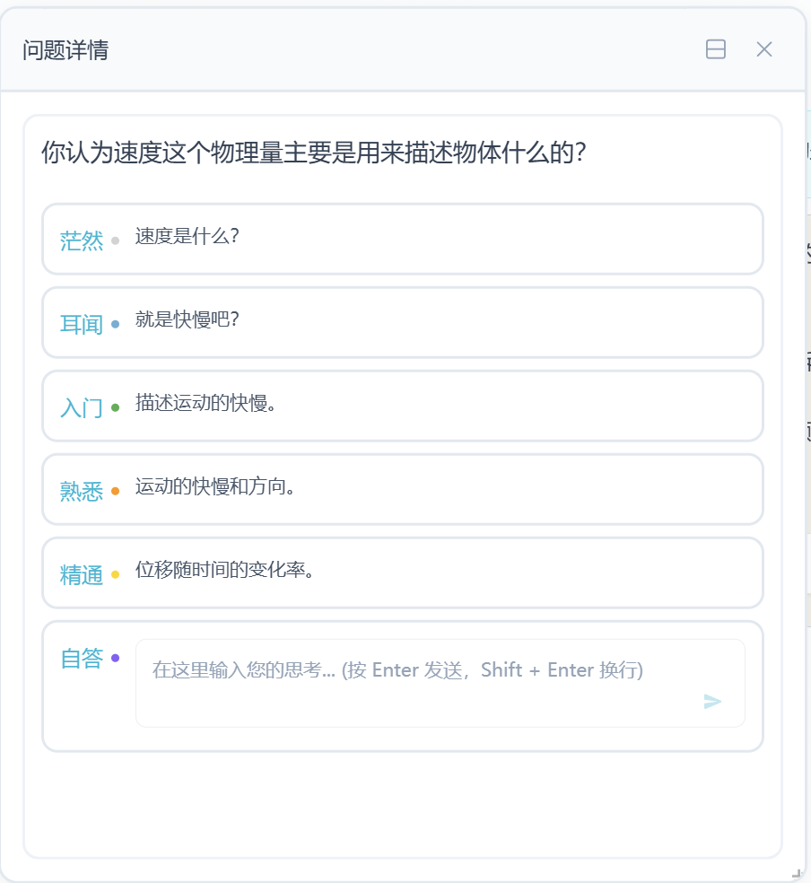
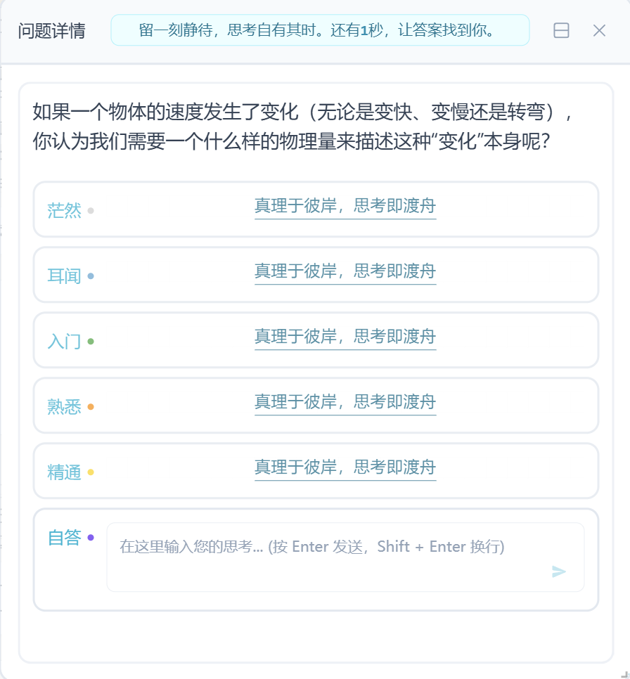

## 开发与阶段归档

Agent 升级 A–G 已完成阶段收尾。开发从 [当前交接](docs/HANDOFF.md) 和根 `AGENTS.md` 开始；[文档索引](docs/README.md) 提供 [开发 Harness](docs/harness/README.md)、[过程复盘](docs/harness/RETROSPECTIVE.md)、[业务知识](docs/knowledge/agent-upgrade.md) 与 [阶段总结](docs/knowledge/agent-upgrade-summary.md)。[完整历史归档](docs/archive/agent-upgrade-2026-11-01/README.md) 保留原始工作包、交接和决策。

这些资料已纳入版本控制。当前行为以业务知识和源码为准。

## 项目基本信息
- **项目名称**：问知轩/WisClick-会问，才会学；会答，更会想。
- **项目简介**：一个高度定制的问答交互框架，采用苏格拉底追问式对答，让与AI的对话更有记忆点。
- **演示截图**：

## 项目亮点
- 苏格拉底式追问问答：通过AI提问倒逼用户思考，加深学习印象。
- 高度定制的**交互系统**：**实时**提取AI的问题，AI实时预测回答，点击即可进行交互降低用户输入负担。

- 用AI对提取的问题进行预测，5个等级的回答：茫然、耳闻、入门、熟悉、精通。同时支持自定义回答。
  
- 停顿、思考、回答：在AI回答完毕以后，点开回答卡片，设置延迟限时答案，并且需要鼠标悬停才能查看答案（可以在设置面板中关闭等待），降低对AI的依赖，鼓励使用者思考。
  
- 自定义模型：支持自己填入baseurl和apikey。
- 纯前端，无需后端，即插即用
- 历史、偏好和模型配置（含 apikey）保存在浏览器 localStorage，支持保存历史对话；模型请求直达你配置的端点。浏览器存储未加密，请勿在公共设备上保存 apikey。
- 支持完整 JSON 备份与导入，以及单个对话的 TXT 导出。默认备份包含 apikey 且未加密，可取消勾选。
- 支持Markdown语法；候选答案卡支持公式渲染，教学正文和问题磁贴暂不支持。
- 支持静态 SVG 讲解卡片与可交互的 HTML 可视化。
- 双语支持

## 安装和使用
- **安装指南**：
  - 环境准备：
    - Node.js 18 或更高版本（建议使用当前 LTS，如 18/20）
    - 包管理器：pnpm（推荐）或 npm/yarn
  - 获取代码：git clone https://github.com/TownBoats/wenzhixuan-public.git
  - 安装依赖（任选其一）：
    - 使用 pnpm：pnpm install
    - 使用 npm：npm install
  - 本地开发：
    - 启动开发服务器：
      - pnpm dev 或 npm run dev 
      - 访问http://localhost:5173
 
## 版本要求
- 运行时环境：
  - Node.js：18+（LTS 推荐，20+ 也可）
  - 包管理器：pnpm 8+（推荐）或 npm/yarn 任一
  - 浏览器：现代浏览器的最近版本
- 关键依赖：
  - Vite 6.x
  - React 18.x，React DOM 18.x
  - React Router DOM 7.x
  - Tailwind CSS 3.x
  - 其他：i18next、react-i18next、framer-motion、react-markdown 等
- 其他说明：
  - 本项目为纯前端应用，无需后端即可运行.

## 直接体验
- **在线演示**：访问[项目在线演示](https://wenzhixuan.com)
- 需要自备模型 API：在模型配置面板填写接口地址、模型名和 apikey；“加载默认配置”只填入 DeepSeek 地址与模型名，不含 apikey

## 使用方法
- 打开项目在线演示[项目在线演示](https://wenzhixuan.com)
- 在模型配置面板填写自己的 API 配置
- 输入讨论的问题，点击“发送”，即可与AI对话
- 默认使用苏格拉底追问；当前界面没有模式切换入口

## 其他
- **许可证**：MIT License
  Copyright (c) 2025 WisClick
- **其他项目**：[CodeMerge](https://github.com/TownBoats/codeMerge.git):一个AI友好的代码合并工具。欢迎star

