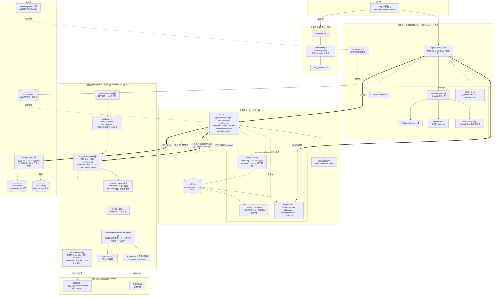
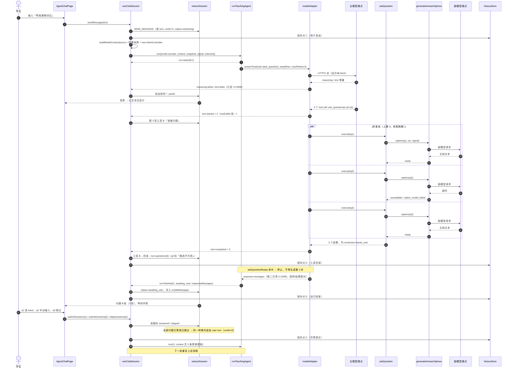
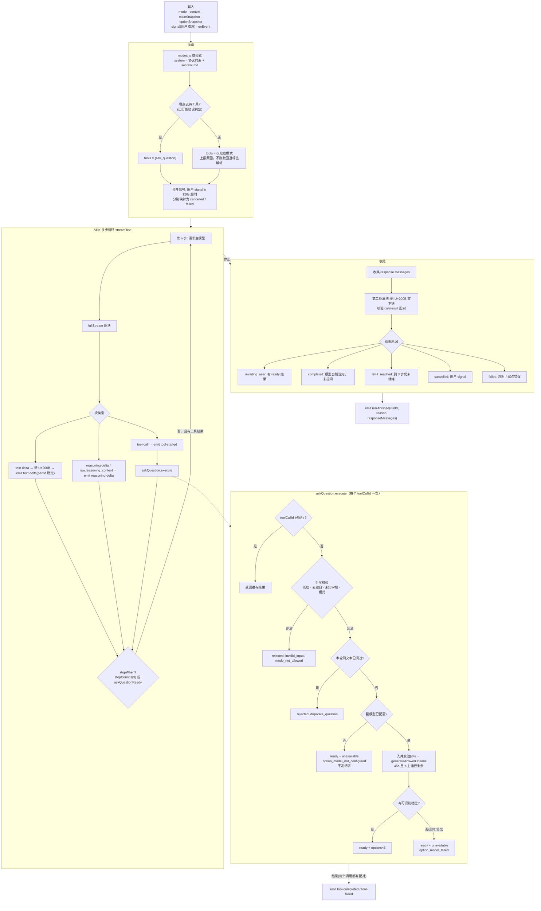
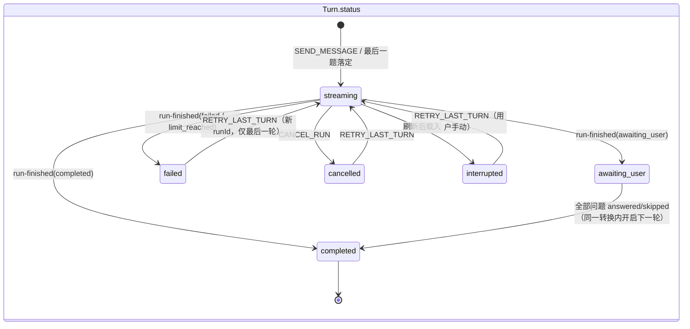
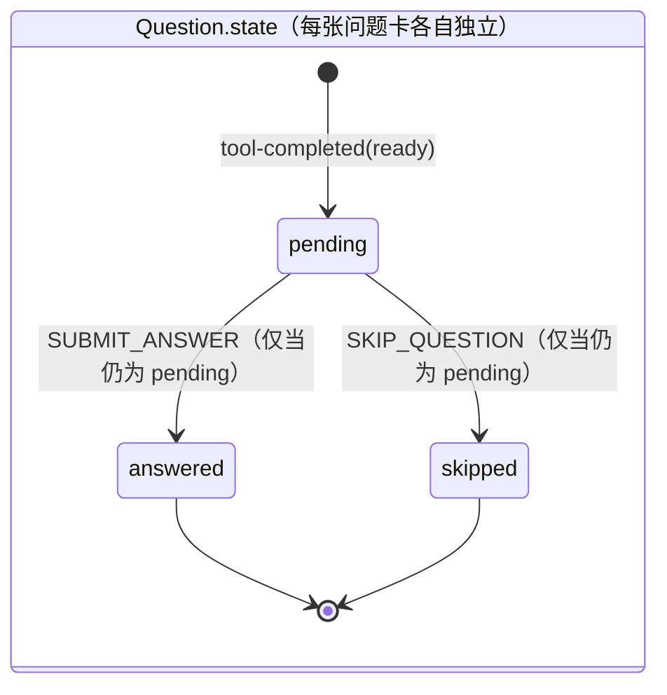
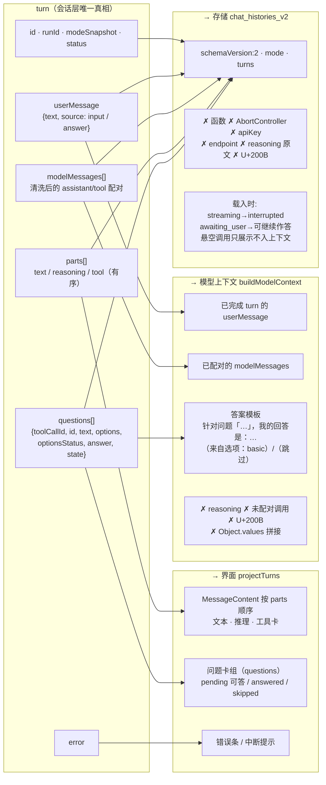
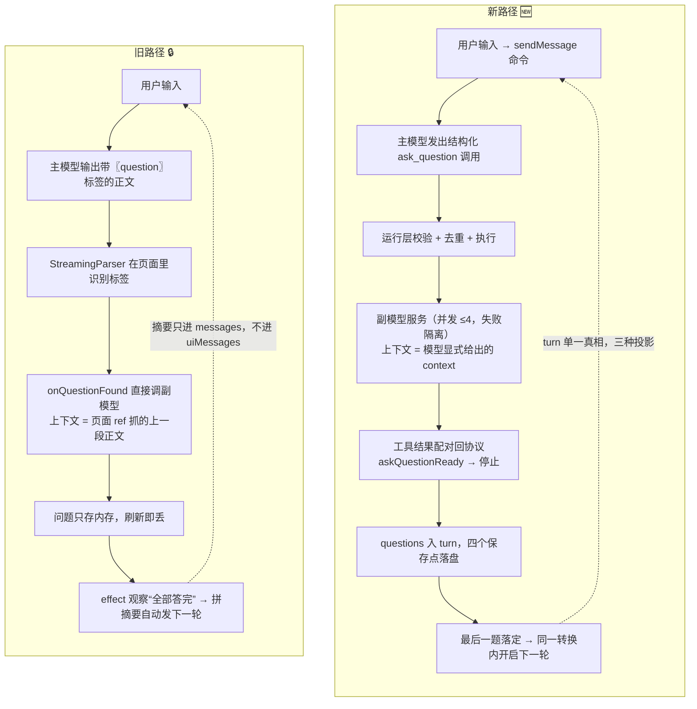

# 02 · 改造后架构图

> 2026-11-01 归档说明：本图为当时目标设计，不代表当前 HEAD 的完整架构。原文见 [历史架构图](../archive/agent-upgrade-2026-11-01/agent-mvp/02-架构图.md)，现行分层、三工具和数据流见 [业务与架构知识](../knowledge/agent-upgrade.md)。

> 依据：`01-核心协议.md`、`决策记录.md`（截至 B-7）、`RULE.mdc` §3/§6、现有源码。
> **实现状态（2026-10-16）**：`src/` 尚未改动，下图中标 🆕 的模块都还不存在；标 ♻️ 的是复用的现有代码；标 🔒 的是旧路径（只读，不改）。图描述的是**拍板后的目标设计**，实施中若有偏离，以决策记录为准并回改本图。

图的阅读顺序：

| # | 图 | 回答什么问题 |
| --- | --- | --- |
| 1 | 全局分层与数据流 | 有哪些层、每层里有什么、数据怎么在层之间走 |
| 2 | 一轮 socratic 的时序（含多问题并发） | 用户发一句话后，各模块按什么顺序做什么 |
| 3 | 运行层内部：一次 `runTeachingAgent` | 工具循环、停止条件、清洗在哪里发生 |
| 4 | 状态机：turn 与 question | 状态怎么转，哪些转换防双击、防迟到 |
| 5 | 一份 turn，三种投影 | 同一份数据如何变成模型上下文、界面、存储 |
| 6 | 新旧路径对照 | 改造到底替换了什么 |

导出的 SVG 在 `docs/agent-mvp/diagrams/`（图 4 拆成 `04a` / `04b` 两张），可以直接用浏览器打开或插入 PPT。**Markdown 里的 Mermaid 源码是唯一事实源**，SVG 只是它的导出结果，改图时先改源码再重新导出（见文末）。

---

## 图 1 · 全局分层与数据流

SVG：[`diagrams/01-全局分层与数据流.svg`](diagrams/01-全局分层与数据流.svg)

实线＝调用/数据，虚线＝事件回推或只读依赖。



**读图要点**

- 展示层到会话层只有一条路：**命令**（①）；会话层到展示层也只有一条：**投影出的渲染数据**（⑨）。展示层拿不到任何 `set*`。
- 运行层只通过 `onEvent` 回推**规范事件**（⑦），从不直接碰状态或存储。会话层先过 `runId` 守卫，再交给 `reduceSession`。
- 配置在**每轮开始时取快照**传入（②）；运行中用户改了设置，不影响正在跑的那一轮。
- 副模型走 `AgentModel`（♻️），主模型走新写的 `modelAdapter`；两者互不 import 对方。
- 兜底无工具模式**不出现在界面上**（B-1），只在「端点不支持工具」时由程序启用（B-6）。缺副模型**不切模式**，只让候选答案变为不可用。

---

## 图 2 · 一轮 socratic 的时序（模型一次提 3 个问题）

SVG：[`diagrams/02-一轮时序.svg`](diagrams/02-一轮时序.svg)



**读图要点**

- 第 2 步之后（`tool-completed`）**不会有第二次模型生成**：停止条件判定的是“问题已就绪”，不是“出现过工具调用”。
- `q2` 的副模型失败只影响它自己（失败隔离），整轮仍然 `awaiting_user`，学生可以手动作答。
- 作答只改问题状态；**最后一题落定的那次转换**才追加 user turn 并发起下一轮。双击时第二次转换的前提不成立，什么都不发生。
- 四个保存点都是状态转换边界；正文增量不单独保存。

---

## 图 3 · 运行层内部：一次 `runTeachingAgent`

SVG：[`diagrams/03-运行层内部.svg`](diagrams/03-运行层内部.svg)



**读图要点**

- **清洗 U+200B 有两处**：流事件里一次（E1），收尾的协议消息里一次（F2）。只清一处，历史和下一轮上下文就会被污染。
- **拒绝也是合法结果**（X4、X6），保证每个调用都有配对。参数非法时不会停（`askQuestionReady` 未命中），模型在步数预算内可以修正一次。
- A 阶段实测 `parallelToolCalls:false` 被接受但**不生效**（A-5），所以 `toolCallId` 去重和同文本去重是唯一防线。
- 未配置副模型（X8）不发请求、不切模式；调用失败（X12）才是网络或解析问题。两种错误码对应不同的界面提示（B-6）。

---

## 图 4 · 状态机：turn 与 question

SVG：[`diagrams/04a-turn状态机.svg`](diagrams/04a-turn状态机.svg)、[`diagrams/04b-question状态机.svg`](diagrams/04b-question状态机.svg)





| 守卫 | 位置 | 防什么 |
| --- | --- | --- |
| `action.runId !== 当前 runId` → 原样返回 | `reduceSession` 入口 | 取消、切换会话、重试后迟到的流片段 |
| 已存在的 `toolCallId` → 更新而非追加 | `TOOL_STARTED / TOOL_COMPLETED` | 重复事件、乱序事件产生两张卡 |
| 问题不是 `pending` → 原样返回 | `SUBMIT_ANSWER / SKIP_QUESTION` | 双击、键盘重复提交 |
| 本轮仍有 `pending` → 不开新轮 | 最后一题落定的判定 | 答到一半就发出下一轮、上下文留缺口 |
| `isRunning` 由 `turns.at(-1).status` 派生 | `deriveViewState` | 旧实现里 `isLoading` 的双写问题 |

工具卡状态（准备中 → 生成中 → 完成 / 不可用）和问题状态是**两套状态**：工具已经完成时，问题仍然可能在等学生作答。

---

## 图 5 · 一份 turn，三种投影

SVG：[`diagrams/05-三种投影.svg`](diagrams/05-三种投影.svg)



旧实现里 `messages`（给模型）和 `uiMessages`（给界面）是两个可以各自修改的 state，已经出现分叉。新实现里只有一份 turn，三种去向都是**由它派生**，不会再出现分叉。

---

## 图 6 · 新旧路径对照

SVG：[`diagrams/06-新旧对照.svg`](diagrams/06-新旧对照.svg)



| 关注点 | 旧 | 新 |
| --- | --- | --- |
| 谁决定提问 | 正文里的标签 + 页面解析 | 模型的工具调用 + 程序校验 |
| 谁决定停下 | 流结束即停，没有业务语义 | `askQuestionReady`（问题已就绪）+ 3 步上限 |
| 副模型上下文 | 页面 ref 隐式抓取 | 工具参数里显式给出的 `context` |
| 状态写入者 | `ChatPage` 多处 `setState` + 两处写 `isLoading` | 只有 `reduceSession` |
| 迟到数据 | 无身份，直接写入 | `runId` 守卫丢弃 |
| 取消 | 没有 | 每次运行一个 `AbortController`，主副模型都中止 |
| 问题持久化 | 不持久化 | `turn.questions` 存入 v2，刷新后可继续作答 |
| 模式 | 靠比对提示词全文推断 | 不设用户可见控件；`socratic` + 程序判定的兜底无工具模式 |

---

## 维护约定

- 本图属于**设计层文档**，和 `01-核心协议.md` 同级。协议变化（新增事件、新增状态、改了停止条件）时，先改协议，再改本图。
- 每个阶段收尾时，把对应模块的 🆕 改为 ✅ 并核对连线是否与代码一致；若实现与本图不符，在 `决策记录.md` 记一条，再改图。
- Mermaid 在 VS Code（Markdown Preview Mermaid Support 插件）、GitHub、Typora 中都能直接渲染。
- **重新导出 SVG**（不进项目依赖，在临时目录执行）：
  ```bash
  npm i @mermaid-js/mermaid-cli@11          # 在任意临时目录
  npx mmdc -i 图.mmd -o 图.svg -b white -c cfg.json
  ```
  `cfg.json` 关闭 `htmlLabels`，让文字输出为 SVG 原生 `<text>`，这样在 PPT/Inkscape 里不会丢字。图 1 节点较多，导出时在源码前加 `config: layout: elk` 前置配置，可以减少连线交叉（需要同时安装 `@mermaid-js/layout-elk`）；Markdown 预览里不加也能看。
