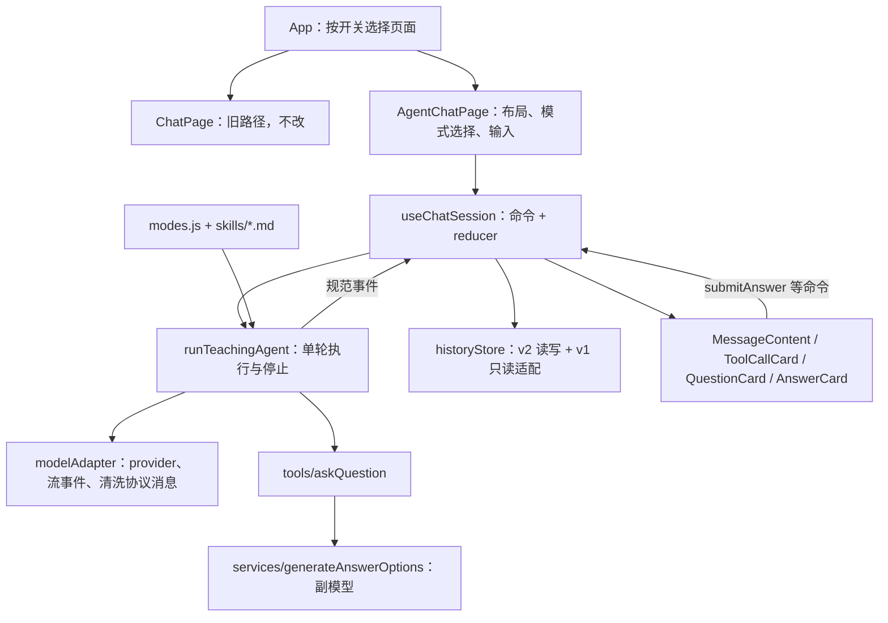

# 问知轩最小 Agent 改造实施方案

日期：2026-10-16（周五，Asia/Shanghai）。计划实施窗口：10 月 16–17 日；10 月 18 日按原计划开始投递。

状态：方案已按源码复核修订，并拆解到可执行任务粒度。产品代码尚未实施，本文不代表功能已完成或通过测试。

**分阶段工作包**：`docs/agent-mvp/`。本文是总纲（目标、代码事实、架构、验收清单）；每个阶段的做法、理由、决策点和监督方法见工作包，协议细节以 `docs/agent-mvp/01-核心协议.md` 为准，决策台账见 `docs/agent-mvp/决策记录.md`。

术语：本文把 `AgentModel.createStreamGateFetch` 注入的零宽空格（U+200B）称为**开闸标记**——它只用于让 provider 立刻开始转发流数据，不属于任何内容。

## 0. 相对第一版的修订

| 修订点 | 原方案 | 修订后 | 依据 |
| --- | --- | --- | --- |
| 实施路径 | 先把旧逻辑搬进 `useChatSession`，再替换为新路径 | 新路径并行建设；旧 `ChatPage` 不改，作为保底版本，用开关切换 | 先搬后换等于同一段逻辑重写两次；18 日需要稳定版本 |
| 模型适配 | `AgentModel` 先复用再按需提取 | 新主路径直接写 `modelAdapter`，`AgentModel` 只留给旧路径和副模型 | `AgentModel` 内置 3 次整轮重试、内部 60 秒超时、不接收外部取消信号、有打字机延迟 |
| 开闸标记 | 未提及 | 适配器必须在流事件和 `response.messages` 两处清除 | `createStreamGateFetch` 给每个 SSE 响应注入一个标记文本块，会进入协议消息和历史 |
| 历史存储 | 同一个 `chat_histories` 数组混存 v1/v2，首次写入前做快照 | 新会话写新键 `chat_histories_v2`，旧键只读；侧边栏按 ID 合并，v2 优先 | 不迁移、不改写旧数据，砍掉快照和回滚逻辑 |
| 用户自定义提示词 | 作为“教学偏好”追加 | 与内置提示词相同则丢弃；用户改过的不自动拼接，设置页提示 | 现存 `mainAgentPrompt` 是含 `〖question〗` 标签协议的完整系统提示词，直接拼接会与工具协议冲突 |
| 停止条件 | 显式停止条件 | 明确为 `stopWhen: [stepCountIs(3), askQuestionReady]`，不用 `hasToolCall` | `hasToolCall` 在参数校验失败时也会停，无法“允许修正一次” |
| 模式切换失效 | 等待回答时可切换，旧问题标记 `superseded` | 首期：运行中或存在待答问题时禁用模式切换 | 减少状态组合；`superseded` 列为后续项 |
| 重试 | 任意轮重试并替换后续分支 | 首期：只允许重试最后一轮 | 分支替换需要截断协议消息，首期收益低 |
| 依赖 | 只提到 `ai` 版本漂移 | `ai`、`@ai-sdk/openai`、`zod` 均漂移；`zod` 不是直接依赖 | `node_modules` 与 `pnpm-lock.yaml` 核对 |
| 新增风险 | — | 推理模型的 `reasoning_content` 不进协议消息；副模型配置门槛；问题状态未持久化 | 见第 2 节 |
| 阶段结构 | A–D 四阶段 | A–F 六阶段，每阶段含任务清单与决策记录 | 本次拆解 |

## 1. 目标与边界

本次只交付两件事：

1. 抽离对话执行与状态管理，让界面渲染不再负责组织模型请求和工具调用。
2. 把现有“提问 + 五档答案”交互改为 Agent 工具调用：主模型通过 `ask_question` 提出问题，副模型在工具内部生成候选答案，用户回答后主模型继续教学。

用户手动选择“常规问答”（`normal`）或“苏格拉底追问”（`socratic`）。模式内由主模型决定讲解、反馈或提问；程序负责注册工具、执行工具、约束次数，并在需要学生回答时停止。

沿用 React、Vite、JavaScript、AI SDK v6 和浏览器 BYOK。继续使用现有 Markdown、问题卡、答案卡、历史列表、模型配置和设计 token。

本期不加入：联网搜索、资料上传、RAG、教学绘图、动态 Skill 检索、多 Agent 编排、后端、跨设备同步、长期学情记忆、全站 UI 重设计、TypeScript 迁移、新的全局状态框架。

## 2. 当前代码事实（2026-10-16 核对）

| 位置 | 事实 | 对本期的影响 |
| --- | --- | --- |
| `src/pages/ChatPage/ChatPage.jsx`（742 行） | 同时负责主请求、流式解析、副模型触发、消息组装、重试、历史同步和页面状态；`isLoading` 由 `runAssistantTurn` 与 `useAgentsConfig` 回调两处写入 | 新路径另建页面，状态由运行状态派生 |
| 同上 `:354-386` | 所有问题都回答后，由 effect 拼接摘要并自动发起下一轮 | 新路径改为显式 `submitAnswer` 命令 |
| `src/lib/AgentModel.js` | `getCompletion` 内有 3 次整轮重试，SDK 默认 `maxRetries` 再叠加 2 次；超时用函数内部创建的 AbortController，外部无法取消；`typewriterDelay` 每 10 字延迟 10ms；传 `maxTokens`（v6 为 `maxOutputTokens`，当前设置未生效）；`compatibility: 'compatible'` 在当前 provider 中已不存在 | 新主路径不复用该类；副模型服务暂时复用 |
| 同上 `createStreamGateFetch` | 在每个 SSE 响应前注入开闸标记，仅在 UI 回调里过滤 | 新适配器需在流事件和 `response.messages` 两处清除 |
| 同上 raw chunk 处理 | `reasoning_content` 从原始 chunk 手动提取，`@ai-sdk/openai` chat provider 不识别该字段，因此不进入 `response.messages` | 要求同轮回传 reasoning 的端点可能在第二步报错；A3 专项验证 |
| `src/hooks/useStreaming.js` + `StreamingParser` | 解析 `〖response〗/〖question〗` 标签，`onQuestionFound` 直接触发副模型 | 仅旧路径使用 |
| `src/hooks/useQuestionFlow.js` | 问题列表只存在内存 reducer 中，不写历史；副模型以“主模型上一段正文 + 问题”为上下文 | 刷新恢复待回答问题是**新能力**，不是保留能力 |
| `src/components/ChatLayout` + `AnswerCard` | 一轮可有多个问题，面板显示“共 N 题”；作答以 UI 专用 `answer-card` 消息追加，不进模型上下文，摘要只进 `messages` 不进 `uiMessages` | 新路径**保留一轮多问题**（探针式教学，见 `决策记录.md` B-3），但改由 turn 状态驱动；两套数组的分叉必须消除 |
| `src/utils/chatMessages.js` | `extractTextContent` 用 `Object.values(...).join` 把对象拼成文本 | 新路径禁止通用拼接，需要显式序列化 |
| `src/hooks/useChatHistory.js` | 键 `chat_histories`；`JSON.parse` 与 `setItem` 均无异常处理；随 `messages` 变化自动保存（流式增量不在 `messages` 中） | 损坏数据会导致页面白屏；新存储需要容错 |
| `src/components/AgentConfigPanel` | `findModeByPrompt` 用提示词全文判断模式；`SYSTEM_PROMPTS.TEST_MODE` 未定义，常规模式实际使用兜底的一句话 | 需改为显式模式 ID |
| `src/services/prompts.js` + `ConfigManager` | `mainAgentPrompt` 保存含标签协议的完整系统提示词；语言切换时会写回 localStorage | 需要提示词迁移规则 |
| `ChatPage` `isModelConfigured` | 要求主、副模型**都**已配置才能开始 | 常规模式应只要求主模型 |
| `ConfigManager` 默认值 | `open.bigmodel.cn` 搭配 `gpt-4o-mini`，两者不匹配 | 本期只记录，不修改 |
| `src/App.jsx` | 直接渲染 `ChatPage`，无路由切换 | 新页面用开关选择 |
| 依赖 | `package.json` `ai ^6.0.173`；锁文件 `ai 6.0.177 / @ai-sdk/openai 3.0.63 / zod 4.4.3`；本机安装 `6.0.280 / 3.0.112 / 4.6.2`；`zod` 只是 peer 依赖 | A1 按锁文件恢复；schema 用 `jsonSchema()`，或把 `zod` 加为直接依赖 |
| 基线 | `vite build` 通过（主包 2.9MB，有体积警告）；`eslint .` 有 15 个错误、3 个警告 | 只要求改动文件 lint 干净，已有问题另行记录 |

已在本机 `ai@6.0.280` 类型声明中确认存在：`stepCountIs`、`hasToolCall`、`StopCondition`、`stopWhen`、`prepareStep`、`activeTools`、`maxOutputTokens`、`maxRetries`、`tool`、`jsonSchema`、`ai/test` 的 `MockLanguageModelV3`，以及 `@ai-sdk/openai` 的 `parallelToolCalls`。A1 需在锁定的 `6.0.177` 上复核。

## 3. 目标架构



分层约束：

- **运行层**（`src/agent/`）：不导入 React，不访问 localStorage，不产生 JSX。输入为模式、配置快照、上下文消息、`AbortSignal`、`onEvent`；输出为规范事件、清洗后的 `responseMessages` 和结束原因。
- **会话层**（`useChatSession` + `conversationState.js` 纯函数）：分配 `conversationId / turnId / runId`，归并事件，用 `runId` 拒绝过期回调，负责保存与投影。
- **展示层**：只接收数据和回调，工具卡不执行工具。

文件落点：

```text
src/
  agent/
    runTeachingAgent.js
    modelAdapter.js
    modes.js
    skills/normal.md
    skills/socratic.md
    tools/askQuestion.js
    services/generateAnswerOptions.js
    __tests__/                      # node --test，只测不依赖别名和 JSX 的模块
  hooks/useChatSession.js
  utils/conversationState.js
  utils/historyStore.js
  pages/AgentChatPage/AgentChatPage.jsx
  components/MessageContent/MessageContent.jsx
  components/ToolCallCard/ToolCallCard.jsx
scripts/                            # 开发期验证脚本，不进 src、不打包
  probe-tools.mjs
  run-socratic-once.mjs
```

## 4. 核心协议（各阶段共用）

### 4.1 `ask_question`

输入（`jsonSchema`，`additionalProperties: false`）：`question`（去空白后 1–500 字符）、`context`（≤2000 字符，可选）。问题 ID 由程序生成。**一轮可多次调用**（每轮问几个由教学指令软引导，代码不设数量硬上限，见 `决策记录.md` B-3）。

`execute` 流程：校验当前模式允许提问、参数合法、本轮未问过相同文本 → 以 `toolCallId` 去重 → 调用 `generateAnswerOptions({ question, context, language, abortSignal })` → 返回结果。

```js
// 成功（每个调用各产生一条）
{ status: 'ready', questionId, question, options: [{ level, text } × 5], optionsStatus: 'ready', nextAction: 'await_user' }
// 副模型失败或五档不完整：问题仍有效，降级为手动输入
{ status: 'ready', questionId, question, options: [], optionsStatus: 'unavailable', errorCode, nextAction: 'await_user' }
// 拒绝（本轮已问过相同文本、模式不允许、参数无效）
{ status: 'rejected', reason }
```

停止条件：`stopWhen: [stepCountIs(3), askQuestionReady]`。`askQuestionReady` 检查最后一步的 `toolResults` 中是否存在 `ask_question` 且 `nextAction === 'await_user'`（**任一**命中即满足）。`execute` 不等待学生作答；学生的回答是下一轮的 `user` 消息，不是工具结果。

预算：每轮最多 3 步；副模型**并发上限 4**（超出排队、失败隔离）；主运行 120 秒，副模型 45 秒且不超过主运行剩余时间；`maxRetries: 0`。同一响应出现多个 `ask_question` 时**全部执行**，每个都返回配对结果，一个都不丢弃。

### 4.2 规范事件

`run-started`、`text-delta`、`reasoning-delta`、`tool-started`、`tool-completed`、`tool-failed`、`run-finished{ reason, responseMessages }`。`reason ∈ completed / awaiting_user / failed / cancelled / limit_reached`。每个事件携带 `runId`；会话层丢弃不属于当前运行的事件。相同 `toolCallId` 视为更新，不追加新卡片。

### 4.3 Turn 记录

```js
{
  id, runId, modeSnapshot, status,     // status: streaming | awaiting_user | completed | failed | cancelled | interrupted
  userMessage,                         // { text, source: 'input' | 'answer', questionId?, selectedLevel? }
  modelMessages: [],                   // 清洗后的 SDK response messages（assistant/tool 配对）
  parts: [],                           // 有序展示片段：text / reasoning / tool
  questions: [],                       // 数组（顺序＝模型调用顺序）：{ toolCallId, id, text,
                                       //   options, optionsStatus, answer, state: pending|answered|skipped }
  error: null,
}
```

模型上下文由已完成 turn 的 `userMessage` 和 `modelMessages` 按顺序组成。reasoning 不回传；未配对的 tool call 不进入上下文。

## 5. 阶段与任务拆解

### 5.0 总览

依赖顺序为 A → B → C → D → E → F，阶段内任务按编号顺序执行。B7 依赖 A3 通过；E 的保存接入依赖 C2。

| 阶段 | 任务 | 核心产出 | 估时 |
| --- | --- | --- | --- |
| A 基线与端点验证 | A1–A4 | 依赖对齐、基线存档、端点探针结论 | 1.5h |
| B 运行层与提问工具 | B1–B7 | `modelAdapter`、模式、`ask_question`、副模型服务、运行层与测试 | 3h |
| C 会话状态层 | C1–C4 | `conversationState` 纯函数、`useChatSession`、Node 闭环 | 2.5h |
| D 页面、模式与设置 | D1–D8 | `AgentChatPage`、工具卡、模式控件、提示词迁移 | 2.5h |
| E 历史存储与恢复 | E1–E4 | `historyStore`、v1 适配、刷新恢复 | 2h |
| F 取消、重试与验收 | F1–F4 | 取消与重试、错误映射、验收记录 | 2h |

### 5.1 阶段 A：基线与端点验证（16 日，约 1.5 小时）

**目的**：在写产品代码前确认依赖可复现，并确认真实主模型端点支持工具闭环。

**问题与约束**
- 要解决：本机依赖与锁文件不一致，今天能调的 API 可能不属于锁定版本；端点若不支持工具调用，后续阶段无从展开。
- 约束：凭据只在本地配置，不写进脚本、测试或日志；mock 不能替代真实端点验证；本阶段不改 UI。

**方案比较**

| | 推荐：按锁文件恢复 + 独立 Node 验证脚本 | 替代：升级到本机 6.0.280 并更新锁文件 |
| --- | --- | --- |
| 做法 | `pnpm install --frozen-lockfile`；脚本从环境变量读端点和密钥，跑一次 `streamText` + 回显工具 + `stopWhen` + 第二步生成 | `pnpm up ai @ai-sdk/openai`，以新版本为准 |
| 优点 | 验证结果与仓库一致；改动最小 | 获得新修复，与本机环境一致 |
| 缺点 | 若 6.0.177 有阻塞缺陷需再升级 | 引入未评估的变更，需回归旧路径 |

**任务清单**

| 任务 | 内容 | 完成判据 |
| --- | --- | --- |
| A1 | 依赖对齐：`pnpm install --frozen-lockfile`，记录 `ai / @ai-sdk/openai / zod` 实际版本；在 6.0.177 上复核 `stopWhen`、`tool`、`jsonSchema`、`MockLanguageModelV3`、`parallelToolCalls` | 三个包版本等于锁文件；`package.json` 无改动；列出的 API 均存在 |
| A2 | 基线存档：跑 `npx vite build`、`npx eslint .`；人工走查旧路径 5 项行为（发送、追问、选择作答、自定义作答、历史恢复、重试） | 输出写入第 8 节；已存在问题清单明确 |
| A3 | 端点探针 `scripts/probe-tools.mjs`，从 `PROBE_BASE_URL / PROBE_API_KEY / PROBE_MODEL` 读取配置 | 打印 5 项用例结果：① 结构化工具参数；② 工具结果回传后生成第二步；③ 思考模型 + 工具 + 第二步；④ 开闸标记是否出现在 `response.messages`；⑤ `parallelToolCalls: false` 是否被接受 |
| A4 | 结论入档：端点是否支持工具闭环；不支持时的备选端点或模型 | 第 8 节有 A 阶段记录；①② 通过才进入 B |

**检查点**：①② 通过。不通过时先解决端点或模型兼容，不写 UI。

**决策记录（完成后填写）**：决定、原因、放弃的方案、仍然存在的风险。

### 5.2 阶段 B：运行层与提问工具（16 日，约 3 小时）

**目的**：在不接触 React 的前提下跑通“模型 → `ask_question` → 副模型 → 停止”的单轮执行，并用 mock 测试覆盖。

**问题与约束**
- 要解决：现在决定“下一步做什么”的是页面里的标签解析器和 effect，不是一个可测试的执行单元；`AgentModel` 不能取消、会重放整轮、会污染协议消息。
- 约束：运行层无 React 和存储依赖；每个 tool call 都有配对结果；`execute` 不挂起等待学生；错误中不含密钥或请求头。

**方案比较**

| | 推荐：工具带 `execute`，内部调用副模型，用自定义 `stopWhen` 停止 | 替代：工具不带 `execute`，SDK 遇到调用后停止，由会话层补写结果 |
| --- | --- | --- |
| 协议含义 | 工具结果 =“问题和候选答案已准备好”；学生回答是新的 user 消息 | 工具结果由应用事后补写，容易被写成学生的答案 |
| 优点 | 一次运行内协议完整，刷新后不会出现悬空调用；副模型失败可降级为结构化结果 | 运行层更简单，无需自定义停止条件 |
| 缺点 | 需要写 `askQuestionReady` 和去重逻辑 | 运行结束时存在未配对的 tool call，下一轮前必须补写结果 |

另放弃：在 `AgentModel` 上增加工具能力。它的重试、超时和打字机逻辑都与工具循环冲突，改动面比新写适配器更大。

**任务清单**

| 任务 | 内容 | 完成判据 |
| --- | --- | --- |
| B1 | `src/agent/modelAdapter.js`：按配置快照创建 provider（内联开闸 fetch）；`maxRetries: 0`；`maxOutputTokens`；接收外部 `AbortSignal`；`fullStream` → 规范事件；清除开闸标记 | 流事件中无开闸标记；`responseMessages` 中无开闸标记；取消后不再发事件 |
| B2 | `src/agent/modes.js` + `skills/normal.md`、`skills/socratic.md`（`?raw` 导入） | `normal`（无工具兜底模式，界面不暴露）不注册工具；`socratic` 注册 `ask_question`；提示词组合顺序为协议 → 模式指令 → 会话内容 |
| B3 | `src/agent/services/generateAnswerOptions.js`：用 `modelAdapter` 跑副模型（45 秒、可取消、`maxRetries: 0`）→ `ContentParser` 解析档位 | 齐全、部分档位、同档重复、零档、请求失败、超时、未配置七种输入各有测试覆盖（注入假 fetch 的 SSE） |
| B4 | `src/agent/tools/askQuestion.js`：`jsonSchema` 校验（长度上限、拒绝未知字段）+ `execute`（`toolCallId` 去重排最前、文本去重、调用 B3、返回四类结果） | 正常、参数非法、`toolCallId` 重放、文本重复、模式不允许、未配置降级、副模型失败降级、程序异常八类有测试 |
| B5 | `src/agent/runTeachingAgent.js`：执行预算（3 步、副模型并发 4）、`askQuestionReady` 停止条件、多个调用**全部执行**且每个都有配对结果 | 用 mock 覆盖停止、一轮多问题、超步数、取消 |
| B6 | `src/agent/__tests__/`：`node --test` + `ai/test` 的 `MockLanguageModelV3` | 6 个用例通过：提问后停止、副模型失败降级、一轮多个问题（含重复文本被拒）、无效参数修正一次、超步数 `limit_reached`、取消后无事件 |
| B7 | `scripts/run-socratic-once.mjs`：用真实端点跑一轮 socratic，打印问题与五档 | 拿到真实问题和五档文本 |

**检查点**：B6 全绿，B7 在真实端点出结果。

**决策记录（完成后填写）**

### 5.3 阶段 C：会话状态层（17 日上午前半，约 2.5 小时）

**目的**：用 reducer 管理会话，把运行事件归并成 turn 记录，对页面只暴露命令。

**问题与约束**
- 要解决：两套消息数组可以各自被修改且已分叉；`isLoading` 有两个写入者；没有取消能力；迟到回调会写进当前会话；作答依赖 effect 隐式触发下一轮。
- 约束：不引入状态库；归并逻辑是纯函数、可测试；同一状态转换内完成“记录答案 → 关闭待答 → 开始新运行”；双击只生效一次。

**方案比较**

| | 推荐：新建 `useChatSession`（`useReducer` + `conversationState.js` 纯函数），只服务新页面 | 替代：先把旧 `ChatPage` 逻辑原样搬进 hook，回归通过后再替换为新协议 |
| --- | --- | --- |
| 优点 | 只写一遍；旧路径保持原样作为保底 | 旧页面也能获得分层结构 |
| 缺点 | 新旧两套代码短期并存 | 同一段逻辑搬两次，搬迁过程中可能破坏 18 日要用的版本 |

**任务清单**

| 任务 | 内容 | 完成判据 |
| --- | --- | --- |
| C1 | `src/utils/conversationState.js`：`reduceSession`、事件归并（`runId` 守卫、`toolCallId` 幂等）、`buildModelContext`、`projectTurns` | 纯函数测试：乱序和重复事件结果幂等；迟到事件被丢弃 |
| C2 | `src/hooks/useChatSession.js`：`sendMessage`、`submitAnswer`、`skipQuestion`、`cancelRun`、`retryLastTurn`、`setMode`、`openConversation`、`newConversation`；每次运行持有自己的 `AbortController`；派生 `isRunning` 与 `pendingQuestion` | 命令齐全；没有任何 `isLoading` 式的双写；渲染数据全部由 turns 派生 |
| C3 | 纯函数测试：双击作答只产生一次运行；上下文无悬空调用、无开闸标记；用户答案按显式模板序列化 | 测试全绿 |
| C4 | Node 驱动闭环：mock 运行层 + reducer 走“发送 → 待答 → 作答 → 新一轮” | 打印的状态序列与预期一致 |

**检查点**：C4 在命令行跑通，说明协议和状态机成立，可以接页面。

**决策记录（完成后填写）**

### 5.4 阶段 D：页面接入、模式与设置迁移（17 日上午后半，约 2.5 小时）

**目的**：让用户在真实页面完成“输入 → 工具卡 → 问题与五档答案 → 作答 → 反馈”的闭环，并用显式模式取代提示词猜测。

**问题与约束**
- 要解决：模式由提示词字符串推断；老用户的 `mainAgentPrompt` 含标签协议，会与工具协议冲突；连不需要副模型的场景也被要求配置副模型；工具执行过程不可见。
- 约束：复用现有设计 token、`QuestionCard`、`AnswerCard`、`MarkdownRenderer`、`ThinkingBlock`；不做全站重设计；状态不只靠颜色区分。

**方案比较（提示词迁移）**

| | 推荐：显式 `teaching_mode` 设置；存储的提示词与任一内置提示词（中英）相同则视为未自定义并忽略；不同则在设置页提示“自定义提示词在新模式下暂不生效” | 替代：把用户提示词作为“教学偏好”追加在模式指令之后 |
| --- | --- | --- |
| 优点 | 协议不会被旧标签规则覆盖；行为可预期 | 保留用户的个性化设置 |
| 缺点 | 自定义提示词的用户暂时失去个性化 | 旧提示词中的“用 `〖question〗` 标签提问”会与工具协议冲突，模型行为不稳定 |

**任务清单**

| 任务 | 内容 | 完成判据 |
| --- | --- | --- |
| D1 | `App.jsx` 增加开关 `agent_runtime`（开发期默认关），选择 `AgentChatPage` 或旧 `ChatPage` | 关闭时行为与今天一致 |
| D2 | ✂️ 已裁剪（`决策记录.md` B-1）：不做用户可见的模式切换控件；无工具兜底模式由程序在「端点不支持工具 / 缺副模型」时启用 | — |
| D3 | `components/MessageContent/`、`components/ToolCallCard/`：按 `parts` 顺序渲染 text / reasoning / tool | 工具卡覆盖“准备问题 / 生成候选答案 / 完成 / 候选答案不可用”四态，可键盘展开参数与结果 |
| D4 | 本轮问题卡组 `QuestionCard` + `AnswerCard` 接入，按 `turn.questions` 顺序一次列出，保留自定义输入与**跳过** | 选项作答、自定义作答、跳过三条路径都能让本轮完成并进入下一轮；卡片数＝问题数 |
| D5 | 配置门槛：无工具兜底模式（仅端点不支持工具时由程序启用）只要求主模型；苏格拉底模式缺副模型时提示配置并允许手动回答，**不切换模式** | 缺副模型时给出可读提示且能手动作答 |
| D6 | 提示词迁移判定函数 + 设置页提示 | 单元测试：中英内置提示词以及语言切换写回的缓存值都被判为未自定义 |
| D7 | i18n 文案（zh / en） | 两种语言下新界面无缺失键 |
| D8 | 真实端点浏览器闭环走查 + 窄屏检查 | 用闭包示例走完正常链路与失败链路 |

**检查点**：D8 通过，功能上可演示。

**决策记录（完成后填写）**

### 5.5 阶段 E：历史存储与刷新恢复（17 日下午前半，约 2 小时）

**目的**：新会话可保存和恢复（含待答问题）；旧历史可读且不被改写。

**问题与约束**
- 要解决：问题状态目前不持久化；存储没有异常处理，损坏数据会白屏；新旧格式需要共存。
- 约束：不批量改写旧数据；保存失败要明确提示；函数、AbortController、密钥不入库；刷新后不自动重放请求。

**方案比较**

| | 推荐：新键 `chat_histories_v2` 保存新会话，`chat_histories` 只读；侧边栏按 ID 合并，同 ID 时 v2 优先 | 替代：同一数组内用 `schemaVersion` 混存，首次写入前备份快照 |
| --- | --- | --- |
| 优点 | 天然不会写坏旧数据；无需迁移和回滚逻辑 | 只有一个数据源，删除和重命名逻辑不变 |
| 缺点 | 删除和重命名要同时处理两个键；总容量仍受 localStorage 限制 | 需要快照、版本判断和失败回滚，工作量和风险都更高 |

**任务清单**

| 任务 | 内容 | 完成判据 |
| --- | --- | --- |
| E1 | `src/utils/historyStore.js`：v2 读写、`JSON.parse` 容错、配额异常返回失败；保存时机为用户发送、工具完成、作答提交、运行结束 | 损坏数据不白屏；模拟配额满时界面有提示 |
| E2 | v1 只读投影为 turns；侧边栏按 ID 合并（v2 优先），删除与重命名同时作用于两个键 | 旧会话继续对话后写入 v2，v1 原样保留且在列表中被隐藏 |
| E3 | 恢复语义：`streaming` → `interrupted`；`awaiting_user` 恢复为可作答；悬空调用不入上下文 | 刷新后手动验证三种状态 |
| E4 | 测试：损坏 JSON、配额满、同 ID 合并、删除两端 | 测试全绿 |

**检查点**：刷新后待答问题可继续回答；旧历史正常显示。

**决策记录（完成后填写）**

### 5.6 阶段 F：取消、重试与验收（17 日下午后半，约 2 小时）

**目的**：补齐失败路径，逐项验收，并决定 18 日使用哪个版本。

**问题与约束**
- 要解决：现有整轮重试不适用于有工具执行的流程；没有取消功能时，迟到的流会污染界面。
- 约束：重试不能在原工具结果后重复追加同一调用；验收结果必须记录端点和日期。

**方案比较（重试）**

| | 推荐：只允许重试最后一轮，丢弃该 turn 的协议消息和问题，以新 `runId` 重跑 | 替代：任意轮重试并截断后续分支（沿用旧语义） |
| --- | --- | --- |
| 优点 | 逻辑简单，不会留下残留协议 | 与旧版行为一致 |
| 缺点 | 无法从中间某轮重来 | 需要截断协议消息和问题记录，测试面大 |

**任务清单**

| 任务 | 内容 | 完成判据 |
| --- | --- | --- |
| F1 | 取消按钮；`AbortSignal` 同时传给主模型和副模型 | 取消后界面停止更新，迟到事件被丢弃 |
| F2 | 重试最后一轮：新 `runId`，丢弃该 turn 的协议消息与问题记录 | 重试后无重复工具卡、无重复工具消息、无旧流污染 |
| F3 | 错误映射：端点不支持工具时显示具体原因与端点/模型名，并说明已降级到无工具兜底模式 | 不静默退回标签解析 |
| F4 | 逐项执行第 6 节验收清单并记录端点、模型、日期；决定 18 日投递版本 | 第 8 节有 F 阶段记录；未通过则开关保持关闭 |

**检查点**：第 6 节清单全部通过，或明确记录未通过项并回退到旧版本投递。

**决策记录（完成后填写）**

### 5.7 时间与裁剪

| 阶段 | 估时 | 累计 |
| --- | --- | --- |
| A | 1.5h | 1.5h |
| B | 3h | 4.5h |
| C | 2.5h | 7h |
| D | 2.5h | 9.5h |
| E | 2h | 11.5h |
| F | 2h | 13.5h |

最低可演示组合为 A–D，加上 E3 中“未完成运行标记为中断”。时间不够时按序裁剪：工具卡细节动画 → 旧会话继续写入 v2 → 刷新后恢复待答问题（降级为中断）→ 跳过问题按钮 → D7 英文文案。

不可裁剪：真实工具调用、调用与结果配对、停止并等待用户、错误可见、旧历史可读、作答只提交一次、协议消息无开闸标记、无悬空 tool call。

## 6. 验收清单

执行时记录端点、模型、日期和结果，方案阶段不勾选。

- [ ] 无工具兜底模式可流式回答：端点不支持工具、或未配置副模型时，程序降级到该模式，不要求配置副模型。
- [ ] 苏格拉底模式真实调用 `ask_question`；`modelMessages` 中调用与结果配对；一轮多个问题时卡片数＝问题数、无重复卡。
- [ ] 五档答案与各问题一一对应；选项作答、自定义作答、跳过三条路径都能让本轮完成并进入下一轮。
- [ ] 问题生成后停止运行；不会出现模型自问自答或无限继续。
- [ ] 工具卡从执行中变为完成；同一 `toolCallId` 不产生重复卡片。
- [ ] 副模型失败时仍显示问题和手动输入入口，不会一直停在加载状态。
- [ ] 无效参数、重复提问、步数上限都有可验证的处理。
- [ ] 连续双击提交只产生一条答案和一次新运行。
- [ ] 取消、切换会话、重试后，迟到的主模型和副模型流不会污染当前会话。
- [ ] 运行中或有待答问题时模式切换被禁用；切换后下一轮生效。
- [ ] 旧历史正常显示且未被改写；新会话的工具卡和待答问题在刷新后可恢复。
- [ ] 刷新后不会自动重放请求；上下文中没有悬空 tool call，也没有开闸标记。
- [ ] reasoning 只在接口实际返回时显示，与工具日志分开。
- [ ] 保存失败有明确提示；复制内容中没有 `[object Object]`、凭据或 reasoning。
- [ ] 旧提示词中的标签协议不会出现在新路径的系统提示中（单元测试）。
- [ ] `pnpm build` 通过；改动文件 lint 干净；全量已有问题单独记录。

自动化测试：`node --test` + `ai/test` 的 `MockLanguageModelV3` 覆盖运行层；纯函数测试覆盖归并、上下文构建、提示词迁移和历史适配。人工验收用闭包示例完整走正常链路和失败链路，并检查窄屏效果。mock 测试不能替代真实端点验收。

## 7. 后续事项（不在本期范围）

切换模式后旧问题标记 `superseded`；任意轮重试；无输出、未执行工具时的传输层重试；副模型改为结构化输出；动态 Skill 检索；验收稳定后删除旧 `ChatPage` 路径与 `StreamingParser`；修正默认模型配置；代码分包。

## 8. 实施决策记录

格式：日期｜阶段｜问题｜选项｜结论｜验证证据｜已知限制。

- 2026-10-16｜方案修订｜第一版方案与源码有出入｜原方案 / 按源码修订｜采用修订版（第 0 节）｜源码核对、`vite build` 通过、`eslint` 15 个错误的基线｜尚未做真实端点验证。
- 2026-10-16｜任务拆解｜阶段过粗不便执行｜按阶段拆 / 单一大任务｜采用 A–F 六阶段、每阶段 4–8 个任务（第 5 节）｜任务编号与完成判据已写入，含依赖关系｜估时为工作块参考，不构成交付承诺。
- （A 阶段开始后逐条补充实际结果。）

## 9. 讨论与学习节奏

每个阶段开始时按“问题 → 候选方案 → 选择理由 → 数据流 → 验证方式”讨论；完成一个小闭环后再复盘。

| 阶段 | 需要能自己解释的问题 |
| --- | --- |
| A | 谁决定下一步？端点是否真的支持工具协议？ |
| B | 为什么工具结果不是学生答案？停止条件在哪一刻生效？ |
| C | 为什么用 `runId` 而不是 `isLoading` 判断迟到数据？ |
| D | 为什么模式要用代码而不是提示词来保证？ |
| E | 为什么只保存最终回答不够？悬空调用从哪里来？ |
| F | 如何证明闭环是在真实端点上跑通的？ |

简历表述在验收后据实填写，例如：“将双模型教学问答流程改造为工具驱动的教学 Agent，分离会话执行与界面渲染，实现结构化提问、候选答案生成、人工作答等待和工具过程展示。”没有数据就不写性能指标。

## 10. 参考与验证边界

- [AI SDK 6.0.177 工具调用与多步执行](https://raw.githubusercontent.com/vercel/ai/ai@6.0.177/content/docs/03-ai-sdk-core/15-tools-and-tool-calling.mdx)：函数签名以锁定依赖为准。
- [Anthropic：Building effective agents](https://www.anthropic.com/engineering/building-effective-agents)：固定工作流与模型自主选择行动的区分。
- [Agent Skills 概览](https://agentskills.io/home)：本期只使用内置教学指令，不声称实现了 Skill 生态。

本文依据当前源码和本机已安装依赖的类型声明整理。尚未运行真实模型验收，未测量成本和延迟，也不承诺所有 OpenAI 兼容端点都支持工具调用或推理协议。

旧文档清理记录：第一版方案已合并并移除 6 份旧调研和方案文档（`升级方案 2026 年 5 月 1 日.md` 以及 `research_agent_upgrade/` 下的 5 份），有用的结论已并入第 2、4、5 节。`维护待办.md`、`docs/REDESIGN_KARE*.md` 和组件 README 保留。`One-Shape-Loop-技.txt` 与本期无关，不处理。
