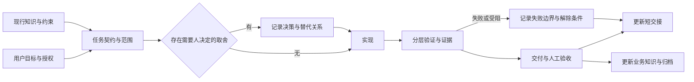

# AI 协作开发 Harness

本文提炼问知轩 Agent 升级过程中的工程方法，面向后续项目复用。整理日期：2026-11-01。它是从一次项目中提取的轻量实践，不表示项目已具备完整的企业级治理、CI/CD、权限审计或发布体系。

这里的 Harness 指围绕编码 Agent 建立的执行环境：上下文入口、约束、任务契约、决策、验证、人工判断、交接与知识维护。产品内部的 `runTeachingAgent` 是应用运行时，与开发 Harness 是两个对象。

## 先读什么

| 需要 | 入口 |
| --- | --- |
| 本项目当前做到哪 | [当前交接](../HANDOFF.md) |
| 按什么方法开展任务 | 本文 |
| 直接复用记录格式 | [模板](TEMPLATES.md) |
| 为什么这样提炼、哪里失效过 | [过程复盘](RETROSPECTIVE.md) |
| 产品现在如何工作 | [业务与架构知识](../knowledge/agent-upgrade.md) |
| 原始过程证据 | [阶段归档](../archive/agent-upgrade-2026-11-01/README.md) |
| 方法结论如何追到原件 | [提取依据](SOURCES.md) |

## 1. 控制面与证据链

可追溯链为：需求 → 任务判据 → 决策 → 代码变更 → 验证证据 → 用户验收 → 发布记录。每个节点引用前后记录，不把整段内容复制到每个文件。

## 2. 各类记录各司其职

| 记录 | 回答的问题 | 更新方式与生命周期 |
| --- | --- | --- |
| 开发规则 | 默认必须守什么 | 少量长期约束；任务特有限制应有结束条件 |
| 任务契约 | 这次交付什么、如何判断完成 | 开工明确，范围变化同步更新；结束后归档 |
| 决策记录（ADR） | 为什么选这个，放弃什么 | 追加新决定，标明替代的旧决定；不重写历史理由 |
| 当前业务/协议知识 | 产品现在是什么 | 随实现更新，注明代码基准和已知差异 |
| 验证证据 | 在什么条件下观察到什么 | 绑定提交或工作树差异、命令、环境、日期、输出与限制 |
| 验收记录 | 谁接受了哪些结果 | 记录用户表态与范围，分开记技术复验状态 |
| HANDOFF | 现在在哪，接下来从哪开始 | 覆盖更新当前快照，保持短小，不作全量会话日志 |
| 历史归档 | 当时发生过什么 | 冻结原文，索引和勘误另外追加；退出默认读取 |

规则、状态、理由、协议、证据分开存放，避免把一个长文件同时当成六种事实源。

## 3. 权限和职责

用户负责产品方向、影响数据兼容的取舍、范围裁剪、验收和发布授权。Agent 负责调查可发现事实、给出取舍、在授权范围实现、验证、如实交接。CI 或本地自动化负责重复执行确定性检查，不能替用户判断教学体验或替代真实服务兼容性走查。

本次原始方法是“前四步不写代码、用户逐项决策、一次授权一个任务、交付后停下”，适合高风险迁移和冷启动协作。本节以下规则是**复盘后的调整**，不是原流程原样照抄：先判断当前指令是否已授权下一步，可逆实现与资料整理在授权范围内持续完成；涉及删除用户数据、公共契约不兼容、真实费用或对外发布，再按实际风险设置门槛。项目默认规则不能代替用户本轮明确授权。

## 4. 风险决定流程深度

| 任务类型 | 最小流程 | 人工检查位置 |
| --- | --- | --- |
| 文案、样式、局部低风险修复 | 简短范围说明 → 修改 → 针对性验证 → 交付 | 用户要求的体验验收；不强制写独立 ADR |
| 跨层功能或状态变更 | 任务契约 → 必要决策 → 实现 → 行为测试与构建 → 交接 | 公共契约、交互语义或兼容策略有分歧时 |
| 外部 API、数据格式或架构迁移 | 基线 → 风险探针 → 契约/ADR → 分批实现 → 自动/集成/人工证据 → 回退计划 | 关键取舍、迁移策略、最终验收与发布 |

一次只推进一个主要交付目标；独立的只读调查可以并行。任务拆分以可验证行为和依赖关系为准，不按固定字母阶段机械串行。A–F 的顺序适合本次迁移，不能成为所有后续工作的永久限制。

## 5. 一项任务的最小闭环

1. **恢复上下文并做入口核对**：先看短交接和 Git 状态，再核对已定决策、实际接口、复用组件 props 和本阶段判据是否一致。若新需求与旧契约冲突，明确替代关系并同步任务、判据和验收，不在实现中悄悄兼容两套语义。
2. **明确交付**：写出问题、授权范围、判据和关键未知。可发现事实自行查证，真正取舍再交给用户。
3. **消除最高风险**：依赖外部模型或服务时，先做窄探针，再扩展实现；记录失败结果同样有价值。
4. **维护契约**：协议变化同步记录输入、输出、事件、失败及兼容性；新决策显式替代旧结论。
5. **实现与验证**：优先验证行为与不变量，不以“调用过函数”代替结果；同时核对实际代码范围。
6. **交付与验收**：分别说明实现状态、自动验证状态、人工验收状态、发布状态，不能用一个“完成”概括四项。
7. **压缩与归档**：当前交接只保留接续所需内容；稳定业务结论进入知识文档，历史任务证据进入归档。

## 6. 证据按作用分类，不互相代替

| 证据类型 | 能支持的结论 | 不能据此声称 |
| --- | --- | --- |
| 静态检查 / 引用分析 | 指定规则通过、某引用链存在或未发现 | 真实交互或服务兼容正常 |
| 纯函数 / SDK mock / 假服务测试 | 给定输入下的事件、状态、错误、取消行为 | 某真实模型支持全部协议 |
| 构建 | 指定源代码能生成产物 | 产品体验和教学效果合格 |
| 浏览器 + 注入数据 | 渲染、交互、布局在指定场景符合预期 | 完成了真实模型闭环 |
| 真实端点闭环 | 指定日期、模型、配置下观察到真实协议行为 | 所有兼容端点永久支持 |
| 用户人工验收 | 用户接受了明确范围的交付 | 自动测试、构建、发布已完成 |
| 发布后验证 | 指定部署版本可访问并通过检查 | 本地或所有用户环境完全一致 |

每份证据至少记录：范围、源代码基准、日期、环境、动作或命令、实际结果、未覆盖项。浏览器验证既有 `dist` 时必须记录产物来源；不知道构建基准，就不能称为当前 HEAD 的验证。

依赖安装失败时记“环境阻塞”，不把测试文件加载失败记成业务断言失败。测试汇总中的文件级失败不能当作完整用例数。历史 lint 问题需绑定基准，不把某次 `15 errors / 3 warnings` 变成永久允许额度。

### 6.1 用具体反问审查 Agent 自述

把“监督与反问”变成可执行的质询，而不是只要求一句“请检查”。典型形式是：先指出可能失败的机制，再要求给出对应观察和证据位置。

| 自述 | 应继续追问 |
| --- | --- |
| “预算已经处理” | 指出真正生效的判断语句，并展示越界输入下的结果 |
| “取消已生效” | 除 signal 传递外，提供连接关闭、请求计数或迟到事件不变状态的证据 |
| “工具只执行一次” | 展示调用 ID、结果配对、重放路径和未决并发边界 |
| “上下文是干净的” | 检查实际发送消息中的 reasoning、标记和未配对调用 |
| “长任务已经跑完” | 给出退出码、结束状态和原始输出位置；只有启动日志不算完成 |

### 6.2 长任务与中断恢复

构建、真实端点或长探针可以后台执行并将输出写入临时文件，但必须回收进程完成状态、退出码和实际输出，再判断成功、失败或受阻。若长任务、子任务或读取因工具/用量限制中断，应记录已覆盖范围和明确缺口，主流程接管剩余工作；不得因已发起任务就宣称已读完或已验证。

## 7. 三种独立状态

| 维度 | 建议取值 |
| --- | --- |
| 实现 | 未开始 / 进行中 / 已交付 / 已裁剪 |
| 验证 | 未运行 / 通过 / 失败 / 环境阻塞 / 部分覆盖 |
| 验收 | 未申请 / 待验收 / 用户接受 / 用户拒绝 |

发布另记：未发布 / 已发布及版本 / 已回退。用户接受交付但当前自动验证受阻是允许记录的事实组合，不能因此倒写成全部测试通过，也不能抹去用户验收。

## 8. 上下文预算与维护责任

短交接目标 80–120 行；持续超过约 150 行时，提炼稳定知识并归档细节。行数是维护信号，不是新审批关卡。只保留当前基准、当前任务、一个明确下一步、待决策和未关闭问题、证据链接。新状态覆盖旧快照；不在当前页面叠加十个“最新补充”。

长期规则目标约 60–100 行，不存提交日志、具体测试数和已经结束的日期约束。跨工具入口只保留必要底线和正文链接，避免两份完整规则独立漂移。

关键机制从软约束逐步转为可运行检查：例如过期事件不变、工具结果配对、存储白名单、真实组件交互。对偶发的诊断和低风险编辑，不为了“流程完整”新增没有价值的测试。

## 9. 阶段关闭

阶段关闭时必须明确：交付范围、验收人/表态、各类证据覆盖、遗留问题与解除条件、Git 基准和是否发布。冻结过程材料，抽取当前知识，归档旧规则并注明何时退出加载。归档后不再让历史提示词拥有当前任务的执行权。

本次归档采用 SHA-256 文件清单保存原文完整性；这只能证明快照字节未变，不能证明其中每句话正确，也不是电子签章或企业合规审计。

## 10. 企业级扩展的边界

本次已有规则、任务契约、ADR、分层验证、人审和交接，形成了轻量 Harness。继续扩展时可依风险引入 CI 必检、PR 审查、制品与提交绑定、部署/回滚记录、问题负责人、数据迁移演练和安全测试。

这些是后续建设方向，当前不能声称已经具备。评估 Harness 的效果应观察返工来源、证据缺口、接手成本、决策追溯能力和异常恢复时间；代码行数、对话次数与“规则写得多”不直接代表工程质量。
