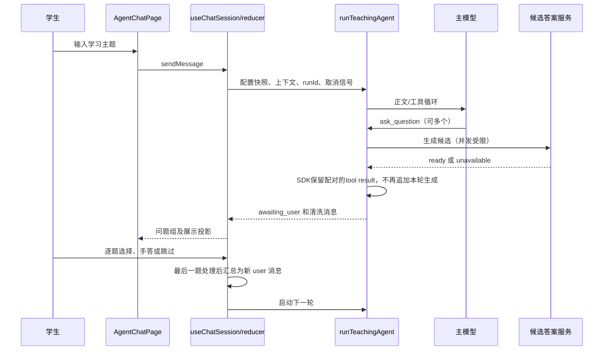

# 问知轩 Agent 业务与架构知识

整理日期：2026-11-01。核对源码基准：`347a6a44f44356102b3e7cd7d6ef393f4c784b2e`。本文件是本轮从历史设计和当前实现提取的现行知识；不改产品协议，不表示本轮重新运行了完整测试或真实模型。历史原件见 [归档](../archive/agent-upgrade-2026-11-01/README.md)，交付规模见 [阶段总结](agent-upgrade-summary.md)。

## 1. 产品目标和边界

问知轩通过苏格拉底式追问帮助学生检查理解。主模型讲解和选择工具，副模型为问题生成分档候选答案，学生选择、手动填写或跳过。一轮所有待答问题被处理后，系统将回答摘要作为下一轮 user 消息继续教学。

产品目前是浏览器内的纯前端应用，模型请求直达配置端点，历史和偏好位于浏览器本地存储。不存在本轮建立的账户、后端持久化、RAG 或组织权限系统。浏览器存储不等于加密保管，不能据“纯前端”承诺 API key 永不泄露。

教学意图是开场按初学者、随后根据实际回答调整深度；先摸底前置知识、缺什么补什么，再用复述/举例/预测检验理解。候选档位是学生自评，不等于已掌握；2–3问是软引导，不为凑数量拆问。静态讲解优先SVG，需要点击/拖拽/参数演示时再用交互HTML。以上由教学指令表达，程序只保证工具集合、状态和协议边界，不保证模型每次都遵守教学策略。

教学效果、候选答案档位是否准确属于产品质量，需要人工或专门评估；协议正确并不能证明学习效果已提升。

## 2. 业务术语

| 术语 | 语义 |
| --- | --- |
| conversation | 一段有固定 ID 的会话，包含多轮 turn |
| turn | 一个用户输入及对应运行、展示片段和问题组；重试保留在同一轮 |
| run | 一次实际运行，带独立 runId，取消或重试要区分旧运行 |
| tool call/result | 模型提出的调用与程序给出的执行结果，不等于学生回答 |
| question | 已就绪的提问记录，状态为 pending / answered / skipped |
| option | 副模型生成的候选回答，不是标准答案；五档为 none/heard/basic/familiar/expert |
| awaiting_user | 运行已结束、问题可作答；不表示工具 execute 仍在等待人类 |
| parts | 展示/诊断片段，可能包含中断或重试内容；不能直接全部当模型历史 |
| responseMessages | 运行层清洗后的 SDK 协议消息，随后由会话层筛选上下文 |
| modeSnapshot | 本轮创建时的教学模式快照，避免改配置后重解释旧轮次 |

## 3. 主业务闭环

同一步出现多个提问调用时逐个处理，不按先返回者裁掉其余问题。问题展示顺序按调用顺序，副模型完成顺序可以不同。学生答案在当前问题上落状态，再按固定模板汇总进入下一轮，避免 UI 直接拼上下文或重复提交。

## 4. 模块职责与当前入口

| 层 | 主要文件 | 职责 |
| --- | --- | --- |
| 应用入口 | `src/App.jsx` | 默认 AgentChatPage；精确 `/design` 显示设计预览，运行时开关已删除 |
| 页面装配 | `src/pages/AgentChatPage/` | 主页面、配置/历史、问题组、错误与旧卡适配；发命令，不接管 reducer |
| 会话控制 | `src/hooks/useChatSession.js` | ID、AbortController、事件派发、配置传入、命令和只读数据 |
| 状态与投影 | `src/utils/conversationState.js` | 纯 reducer、上下文组装、展示投影、派生运行状态 |
| 运行编排 | `src/agent/runTeachingAgent.js` | 三工具装配、预算、并发、停止条件与结束原因 |
| 模型适配 | `src/agent/modelAdapter.js` | 端点规范化、SDK 流事件转换、取消/超时、两处标记清洗 |
| 模式与教学 | `src/agent/modes.js`、`modePrompts.js`、`skills/*.md` | 显式模式与工具集合；只有装配入口使用 Vite raw 导入 |
| 工具与副模型 | `src/agent/tools/`、`services/generateAnswerOptions.js` | 输入校验、幂等、候选生成或本地结果构建 |
| 持久化 | `historyStore.js`、`historyV1.js`、`useConversationHistory.js` | 存储清洗、v1 投影、启动恢复、保存与列表 |
| 展示 | MessageContent/ToolCallCard/QuestionGroup/AnswerCard/VisualizeCard/ExplainCard | 渲染数据和回调，工具卡不执行工具 |

`normal` 模式注册零工具；`socratic` 注册 `ask_question`、`visualize`、`explain_card`。用户可见的模式切换控件已裁剪，代码中存在 normal 不代表当前 UI 有可操作入口。

主教学指令由模式决定，旧 `mainAgentPrompt` 不自动合入。候选答案提示词仍从配置读取；迁移通知保留关闭状态，但旧入口文案需要修正。

## 5. 工具契约

| 工具 | 输入与校验 | 输出与运行影响 |
| --- | --- | --- |
| `ask_question` | question 去空白 1–500 字符，context 可选、至多 2000；未知字段拒绝，另做模式与本轮重复文本检查 | 程序生成 questionId；ready 结果含 question/options/optionsStatus/nextAction；`nextAction:'await_user'` 触发停止 |
| `visualize` | title 1–80，html 至多 60,000 字符，校验字段与非空 | 返回可渲染 HTML；不等待学生，不触发提问停止条件 |
| `explain_card` | title 1–80，svg 至多 30,000 字符，检查 SVG 形状、viewBox 等 | 返回 SVG 讲解结果及 viewBox；不打断运行 |

三个工具有每运行实例内的调用 ID 结果缓存，已经完成的同 ID 重放可复用结果；这不构成跨刷新或跨服务的 exactly-once 保证，异步提问中尚未完成的并发同 ID 调用也不能仅凭结果缓存宣称严格只执行一次。提问还按修剪后的完整文本去重；它不是语义相似度去重。提问拒绝包括 invalid_input、duplicate_question、mode_not_allowed、internal_error；副模型失败通常是问题 ready 但 optionsStatus unavailable，仍可手动回答。

JSON schema 是第一层声明，工具内手写校验是第二层。SDK 可以在 execute 前产生 tool-error；不能把所有非法参数都描述为必然返回业务 rejected。

候选答案服务现在是单次非流式 `generateText`，强制调用 `submit_options` 作为 JSON 结构化出口；不是旧 ContentParser 标签解析，也不经主运行的 `runModelTurn`。模型提交 `{options:[{level,text}]}`，服务清洗为已知档位、可用文本和稳定顺序，缺档按实际显示，不硬编码始终五条。对特定端点注入关闭思考参数是兼容性处理，不能外推所有 OpenAI 兼容服务均支持强制工具。

## 6. 预算、停止与失败

- 主运行最多 3 步，固定 120 秒；副模型最多 45 秒且不超过主运行剩余预算；候选服务并发上限 4，超出排队。
- 重试参数为 `maxRetries:0`，整轮重试由用户命令处理。
- 停止条件是 `stepCountIs(3)` 或最后一步某个 ask_question 结果带 `nextAction:'await_user'`；不是仅看到工具名就停。
- 结束原因保留 completed / awaiting_user / failed / cancelled / limit_reached。
- turn 状态没有 limit_reached，归为 completed；不能据 turn.status 单独还原全部运行结束原因。
- timeout 与 cancelled 区分，`errorKind` 只保存 timeout / failed / null。取消不展示失败错误块。
- 工具不受支持的识别仍含错误字符串匹配；端点只回笼统 Bad Request 时未必识别得出。

原始工具配对不变量的实际边界是：发送给模型的上下文只包含配对消息。取消中的工具展示片段可能仍处于 running；失败/取消轮整体不进入后续上下文，不能承诺任何时刻 UI 都没有未终结工具片段。

## 7. 状态、事件和身份

turn 核心字段：id、runId、modeSnapshot、status、userMessage、modelMessages、parts、questions、error、errorKind。问题包含 toolCallId、id、text、options、optionsStatus、answer、selectedLevel、state。

turn 状态为 streaming / awaiting_user / completed / failed / cancelled / interrupted。question 状态为 pending / answered / skipped。运行状态与待答数量从 turn 派生，不另维护一份可写 isLoading。

规范事件包括：run-started、text-delta、reasoning-delta、tool-input-started、tool-input-delta、tool-started、tool-completed、tool-failed、run-finished，均关联 runId。参数事件比完整 tool-call 更早创建卡片，为 SVG 预览提供部分字符串；预览不等于工具执行成功。

会话层先校验当前 runId 和运行状态，忽略迟到片段。取消时允许对应的最终收尾写回，避免丢失结果；hook 根据 runner 的最终返回统一派发 RUN_FINISHED，避免事件和 Promise 两路重复结束。

重试仅作用于最后一轮；换 runId，保留已显示的旧内容和问题。文本合并与 React key 需要同时包含 runId 和 partId，因为 partId 可在不同运行重复。旧 pending 问题保留是历史已接受的语义，具有需要继续评估的风险。

## 8. 三种数据投影

| 投影 | 纳入内容 | 排除内容 |
| --- | --- | --- |
| 模型上下文 | awaiting_user / completed 轮的 user 输入及清洗后配对 assistant/tool 消息；新一轮输入由 hook 补入 | failed/cancelled/interrupted/streaming 历史轮、reasoning、未配对调用、U+200B |
| UI | 有序 parts、工具卡、问题状态、必要错误；重试旧内容可保留 | 不把渲染本身当作模型历史或工具执行 |
| 存储 | 明确字段清洗后的会话、轮次、协议与问题数据 | 配置凭据、控制器、函数、reasoning 原文、U+200B 和临时工具参数预览 |

上下文允许 awaiting_user，是因为模型生成已经完成、工具有结果，学生尚未作答。不能笼统写成“只有 status===completed 才能入上下文”。

学生回答模板固定显式列出问题、答案、选项档位或手动输入；跳过明确写出学生未作答。不能用遍历对象所有值拼接的方式构建上下文。

## 9. 历史与恢复的业务语义

- 新键 `chat_histories_v2`，schemaVersion 2；旧键 `chat_histories` 继续兼容读取，列表按 ID 合并，新键优先。
- 新会话和续聊写 v2，不自动批量迁移 v1。用户主动删除可作用两键；重命名优先已有 v2，否则改旧条目的标题。
- 只有续聊过的旧会话才产生同 ID 的 v2 记录；未续聊旧数据仍只存在于 v1。若未来清理旧键，必须先盘点哪些记录已有 v2 副本，不能把“兼容读取”误当成“全部已经迁移”。
- 启动恢复最近更新会话，打开已有会话不会自动重发模型请求；历史 streaming 降为 interrupted。
- v1 由 `historyV1` 现场投影，旧答案卡摊平文本，旧题不恢复成可作答问题；适配不依赖旧 UI/解析器。
- 保存按用户发送、工具完成、作答提交、运行结束四类变化由签名驱动，避免每个流片段落盘；这不等于已经验证浏览器崩溃下具备数据库事务保证。
- 存储失败显式返回原因并提示；配额/不可用/损坏分别处理，不能假装已保存。
- reasoning 保存时剥离，刷新后不再展示原思考块属于当前策略。
- 新旧键仍各自整数组覆盖，没有多标签页写入协调或数据库事务；分键降低迁移风险，不保证永不覆盖或丢失新数据。当前签名只覆盖末轮结构，不支持由此推断任意历史编辑都会触发保存。

`historyStore` 的结构白名单用于正常业务数据清洗，不应称为对任意嵌套文本或工具 payload 中秘密的通用 DLP。模型配置有独立的本地存储，不能把“历史不含 apiKey”说成“整个浏览器不存 apiKey”。

## 10. 生成内容的信任边界

VisualizeCard 的 iframe 使用 `sandbox="allow-scripts"`，没有 allow-same-origin；CSP 禁止 connect-src，但允许指定脚本 CDN、字体和 https 图片。高度通信校验消息来源。该组合隔离宿主 origin 能力，但不是零网络环境，不能声称所有外部请求被禁止。

ExplainCard 就绪态使用空 sandbox 和限制性 CSP，不给模型脚本执行权限；流式态允许宿主桥接脚本，模型增量经标签/属性过滤再进入 DOM，桥接校验消息来源。参数文本可能还未形成合法最终工具输入，最终结果与流式预览须区分。

这些是源码中可见防护，不是本轮已完成的攻击面审计。应继续评估外部资源、任意生成 HTML、CSP/导航行为、SVG 过滤覆盖、消息通信和持久化载荷；本轮没有发起安全测试。

## 11. 兼容依赖和清理边界

新路径仍使用 AnswerCard → MarkdownRenderer，以及 ModelConfigPanel、ConfigManager、SettingsSection、AnswerWaitSettings、useMediaQuery、answerPreferences、候选提示词服务。不能按“旧组件目录”整体删除。QuestionCard 组件无当前主路径入口，但 questionAdapter 文件仍有现行答案适配函数，测试也引用其旧适配函数。

旧 ChatPage 及专用 hooks/lib/解析器/旧 UI 是静态删除候选；删除前仍需依赖与运行验证。`/design`、ui-review 是有效开发入口，闲置 LandingPage 用途另行判断。历史兼容和旧配置键的退役需要单独产品决定。

## 学习链路（2026-11-01 实现，ADR-001）

学习记录是第四种数据投影：由会话派生、独立存储、**不进入教学上下文**。链路图内嵌在消息流末尾，有对话时以一行淡色文字按钮出现，默认收起，展开后为目标一句话加横向节点图；窄屏横向滚动。

组成：

| 层 | 文件 | 职责 |
| --- | --- | --- |
| 纯函数 | `utils/learningJournal.js` | 单元推导、证据池、提取输入、产出校验、折叠、指纹与调度判断 |
| 存储 | `utils/learningJournalStore.js` | 独立键 `learning_journals_v1`，失败回 `{ ok, reason }`，整键损坏拒写 |
| 提取器 | `agent/services/extractLearning.js` | 单次非流式 `generateText` + 强制 `submit_learning_update`，30 秒，`maxRetries: 0` |
| 提示词 | `agent/skills/learning-extractor.md` | 经 `modePrompts.js` 的 `?raw` 导出，服务只接字符串 |
| 调度 | `pages/AgentChatPage/useLearningJournal.js` | 对账式串行提取、会话切换中止、迟到结果丢弃 |
| 展陈 | `pages/AgentChatPage/LearningChain.jsx` | 折叠入口与节点图；状态分为 empty / extracting / unavailable / failed / ready |

关键口径：

- 节点由 `topic`（概念主题，2–10 字名词短语，界面上的标题）、`type`（六类状态，降为小标签）、`points`（1–2 条短 bullet）、`evidence` 组成。标题写概念不写状态，折叠只合并「同主题同状态」。
- 单元 `U(T)` 需 T 合格（completed / awaiting_user）且 T+1 已创建；尾单元仅在用户展开时按需提取。
- 证据池只收**手答**与 `source === 'input'` 的自由输入。点选候选的文本是副模型生成的，与手答同存在 `question.answer`，靠 `selectedLevel` 区分；答案汇总轮含题干与模板，整段不做证据。
- 结果有效性存 `inputHash` / `prevDigest` / `extractorVersion` 三个指纹，覆盖「尾轮部分作答」与「前序重算」两种失效；当前提取器版本为 `v2`（节点带主题）。
- 失败**遇错即停**并在下一轮对话重试；同一批 turns 下不自动重复请求，避免失败循环。
- 未配置副模型时不发任何请求，链路显示为不可用；首份记录由用户展开链路时显式触发，避免打开旧会话就批量消耗。
- 保存失败显式暴露，不假装已存。删除会话时联动删除学习记录，其失败不升级为会话删除失败。

未做：回流教学、跨会话档案、历史压缩，均需新 ADR。真实模型提取质量仍未验证，mock 只证明通道与校验。

### 本机依赖布局

Windows 在本机禁止跨 junction 访问 `.pnpm`（`untrusted mount point`），pnpm 默认链接布局会让所有依赖“存在但读不到”，并伪装成缺包错误。项目 `.npmrc` 因此设 `node-linker=hoisted`：依赖平铺复制，不使用 junction。它只改变 `node_modules` 结构，不改 `pnpm-lock.yaml` 与依赖版本；换机器或文件系统允许链接时可再评估。诊断判据是：`node_modules/<pkg>` 存在但读取内部文件报路径不存在，或 `dir` 显示空目录。

## 12. 证据、已知问题和修改入口

本轮只做源码核对与资料整理。A–F 历史自动项、真实模型证据、G 人工验收和当前回归缺口见 [阶段总结](agent-upgrade-summary.md)。下一动作和未关闭问题由 [短交接](../HANDOFF.md) 维护，不在本文复制会话日志。

修改教学行为读 skills/modes；修改工具契约读 tools 和对应测试；修改并发与停止读 runTeachingAgent；修改流协议读 modelAdapter/hook/reducer；修改恢复读 historyStore/historyV1/useConversationHistory；修改生成展示读工具和 iframe/CSP 两侧。

锁文件基准包含 `ai 6.0.177`、`@ai-sdk/openai 3.0.63`、`zod 4.4.3`、`react-markdown 9.1.0`。历史文档中的 react-markdown@10 不是当前依赖事实。依赖版本后续可按任务改变，变更应带相应验证和记录。
